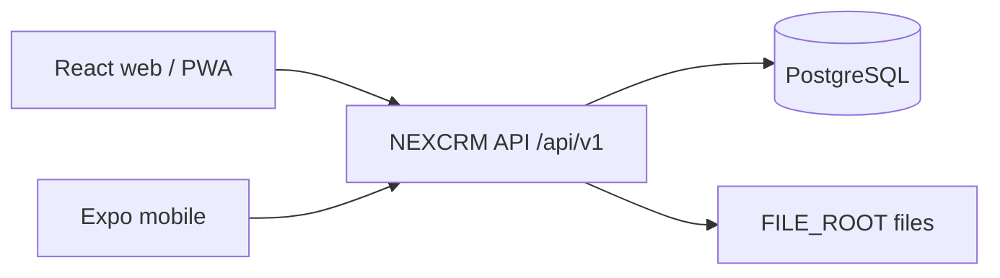

# NEXCRM

Office **super app** for manpower agencies: employment tools plus finance apps, on one PostgreSQL backend and one JSON API shared by the React web client and the Expo mobile client.

| Layer | Stack | Location |
| --- | --- | --- |
| API + static host | Node (TypeScript), Drizzle, PostgreSQL | `app/`, `modules/`, `lib/`, `db/` |
| Web | React + Vite + shadcn (PWA-installable) | `web/` |
| Mobile | Expo (React Native) | `mobile/` |



## Product pillars

1. **Agency CRM / HR** — employers & clients, employees, onboard (passport OCR), allocations, LOAs, work permits, projects/sites/slots, accommodations, per-client payroll, documents.
2. **Finance apps** (sidebar app launcher) — Expenses today; Investments and finance-oriented Projects planned under `/apps/*`.
3. **Settings** — people, roles (per-module permissions), office prefs, OCR key, health.

**Agents:** start at [AGENTS.md](AGENTS.md), then [docs/](docs/README.md). See [docs/PRODUCT.md](docs/PRODUCT.md) for the module map.

## Quick start (dev)

```bash
# API (serves built web from web/dist)
cp .env.example .env   # DATABASE_URL, FILE_ROOT, optional OPENAI_*
npm start              # http://127.0.0.1:3000

# Web (dev)
cd web && npm install && npm run dev

# Mobile (Tailscale API — see mobile/README.md)
npm run mobile:install && npm run mobile
```

## Production (this server)

nginx + systemd + Tailscale Serve are installed. See [docs/DEPLOY.md](docs/DEPLOY.md).

| Access | URL |
| --- | --- |
| Local | http://127.0.0.1/ |
| Office LAN | http://192.168.100.10/ · https://192.168.100.10/ |
| Tailscale | https://server-1.snowy-pride.ts.net/ |

PostgreSQL TCP is open to LAN + Tailscale (password in `deploy/database-network.env`, not committed).

```bash
sudo systemctl status nexcrm nginx postgresql
cd web && npm run build && sudo systemctl restart nexcrm
```

Migrations run automatically on service start. System admin can store the OpenAI API key under **Settings** (`/settings`) for passport OCR.

## Documentation

| Doc | Purpose |
| --- | --- |
| [AGENTS.md](AGENTS.md) | Agent catch-up (rules, paths, commands) |
| [docs/README.md](docs/README.md) | Docs index + reading order |
| [docs/MASTER_PLAN.md](docs/MASTER_PLAN.md) | Living full-repo orientation |
| [docs/ARCHITECTURE.md](docs/ARCHITECTURE.md) | Monorepo layout, auth, clients, apps launcher |
| [docs/API.md](docs/API.md) | `/api/v1` surface for web + mobile |
| [docs/PRODUCT.md](docs/PRODUCT.md) | Agency + finance product map |
| [docs/DEPLOY.md](docs/DEPLOY.md) | nginx, systemd, network Postgres |
| [docs/REMOTE.md](docs/REMOTE.md) | Tailscale SSH + Cursor remote |
| [mobile/README.md](mobile/README.md) | Expo run / Tailscale API base URL |
| [mobile/AGENTS.md](mobile/AGENTS.md) | Mobile agent notes |

## Design rules (locked)

- One API for all clients — no separate mobile backend.
- Agency model: legal **employer** companies second workers to **client** companies; dual staff salary vs bill rate; immutable allocations / pay runs / letters once committed.
- Finance **apps** hang off the sidebar launcher (`web/src/lib/apps.ts`), not the main Operations nav.
- Files live under `FILE_ROOT` (default Desktop `nexcrm-files` on this server).
