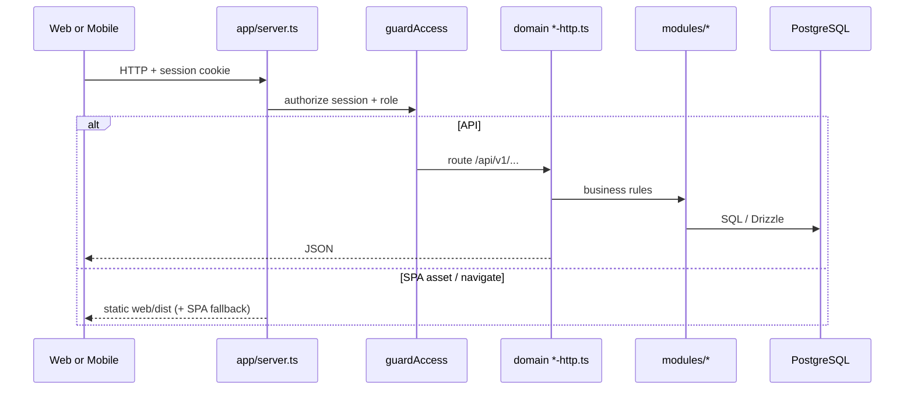

# Architecture

Full product + codebase map: [MASTER_PLAN.md](MASTER_PLAN.md).

NEXCRM is a single Node HTTP server that:

1. Serves the production React SPA from `web/dist` (including PWA assets).
2. Exposes JSON APIs under `/api/v1/*` used by **web** and **mobile**.
3. Talks to **PostgreSQL** via `pg` + Drizzle schema in `lib/schema.ts`.
4. Stores uploads under `FILE_ROOT` (file metadata in `files` / `file_links`).

## Monorepo layout

```
nexcrm/
  app/           HTTP entry (server.ts), routers (*-http.ts), static SPA
  modules/       Domain logic (access, companies, hr, expenses, files, settings, …)
  lib/           db, env, migrate, schema, health
  db/migrations/ Ordered SQL migrations (auto-applied on boot)
  web/           React + Vite office UI (PWA)
  mobile/        Expo client (same API, Tailscale base URL)
  docs/          Product & API documentation
  tests/         Node strip-types smoke tests
```

## Request flow



## Auth

- Cookie session: `nexcrm_session` (HttpOnly, SameSite=Lax).
- `POST /login`, `POST /logout`, `GET /api/v1/session`.
- Roles in `roles` / `users` (`system_admin`, `hr_manager`, …). Coarse flags plus per-module View/Create/Edit/Delete in `role_permissions` (`modules/access/permissions.ts`).
- Settings hub routes: `/settings` (also `/users`, `/admin`) → General / People / Roles / Health.

Mobile uses the same cookie/session model against the published API origin (see `mobile/src/lib/config.ts`).

## Frontend apps

### Web (`web/`)

- Vite React SPA; production build copied/served from `web/dist`. Soft SPA nav via `web/src/lib/spa-nav.ts` + lazy routes in `App.tsx`.
- Shell: Workspace + Operations + **Settings**; **app icon launcher** above the user footer (`web/src/lib/apps.ts`); mobile bottom nav.
- PWA: `manifest.webmanifest`, `sw.js`, install prompt.
- Integrations UI: OpenAI OCR key, office/region/currency under Settings → General.

### Mobile (`mobile/`)

- Expo Router tabs + stack screens for core agency flows.
- **Must** call the same `/api/v1` contract — no parallel business logic on device beyond UI.

## Domain modules (backend)

| Area | Module folder | Notes |
| --- | --- | --- |
| Access | `modules/access` | Sessions, roles, users, permission matrix |
| Companies | `modules/companies` | Employer / client kinds |
| HR / agency | `modules/hr` | Employees, allocations, attendance, payroll, designations, OCR onboard |
| Projects | `modules/projects` | Projects, sites, pools, slots |
| Documents | `modules/documents` | LOAs / letters, snapshots |
| Files | `modules/files` | Upload / download / vault |
| Expenses | `modules/expenses` | Finance app v1 |
| Settings | `modules/settings` | Office prefs + OpenAI OCR |
| Integrations | `modules/integrations` | XPAT sync helpers |

## Data & migrations

- SQL files in `db/migrations/` (`001_…` through `027_role_permissions.sql`, …).
- `lib/migrate.ts` applies pending files on server start.
- Drizzle mirror: `lib/schema.ts` (keep in sync when adding tables). See [MASTER_PLAN.md](MASTER_PLAN.md) for the migration table.

## Environment

See `.env.example`:

- `DATABASE_URL` — PostgreSQL
- `FILE_ROOT` — absolute path for binary storage
- `HOST` / `PORT` — API listen address
- `OPENAI_API_KEY` / `OPENAI_OCR_MODEL` — optional env fallback; preferred store is System settings DB

## Extending the super app

1. **New agency feature** — module + `*-http.ts` + web page under existing nav; add mobile screen if needed; document in `docs/API.md`.
2. **New finance app** — row in `web/src/lib/apps.ts`, route `/apps/<slug>`, own module + `/api/v1/<resource>`; keep CRM Operations nav clean.
3. **Never** fork business rules into the mobile app — call the API.
