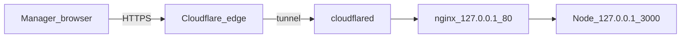

# Cloudflare Tunnel (public NEXCRM / JACMS)

Expose this office app on the internet **without** opening router ports or using Tailscale for managers.

**Hostname walkthrough** (`https://server.bluraymaldives.site`): [guides/cloudflare-tunnel-server-bluraymaldives.md](guides/cloudflare-tunnel-server-bluraymaldives.md).

## Why Tunnel

| Approach | Notes |
| --- | --- |
| ISP port-forward / DMZ | Opens the LAN host; fails under CGNAT; certs awkward |
| Tailscale | Great for admins/SSH; managers need the Tailscale app |
| **Cloudflare Tunnel** | Outbound-only connector; HTTPS on your hostname; no Huawei port map |

Node stays on `127.0.0.1:3000`. Tunnel points at local **nginx** `http://127.0.0.1:80`.



## Prerequisites

1. A domain on a Cloudflare account (DNS managed by Cloudflare).
2. This server online with `nexcrm` + `nginx` healthy.
3. Leave Huawei **DMZ Disable** and do **not** add WAN port mapping for 80/443.

## One-time install

```bash
cd /home/server/dev/nexcrm
sudo bash deploy/install-cloudflare-tunnel.sh
```

Then complete Cloudflare login + hostname (interactive once):

```bash
# As the service user (or with sudo -u)
cloudflared tunnel login
# Opens a browser URL — authorize the domain

sudo bash deploy/install-cloudflare-tunnel.sh \
  --hostname nexcrm.example.com \
  --tunnel-name nexcrm
```

This creates:

- Named tunnel `nexcrm`
- Config `/etc/cloudflared/config.yml` → `http://127.0.0.1:80`
- DNS CNAME for the hostname
- systemd unit `cloudflared`

## Day-2

```bash
systemctl status cloudflared
journalctl -u cloudflared -n 50 --no-pager
curl -sS https://nexcrm.example.com/health
```

Mobile / managers: set app base URL to `https://nexcrm.example.com`.

## Security limits

- App login still required (NEXCRM sessions).
- Postgres `:5432` stays LAN + Tailscale only — never publish it through the tunnel.
- Do not point the tunnel at Node `:3000` directly if nginx already terminates headers/body size.
- Optional later: Cloudflare Access (email OTP) in front of the hostname.

## Temporary test without a domain

```bash
cloudflared tunnel --url http://127.0.0.1:80
```

Prints a random `*.trycloudflare.com` URL (ephemeral — not for restaurant managers).
