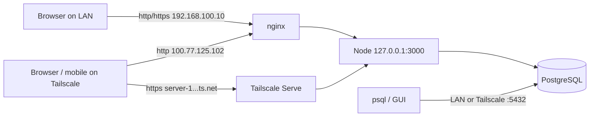

# Deploy — web app + network database

## What runs where

| Component | Bind | Who reaches it |
| --- | --- | --- |
| Node NEXCRM | `127.0.0.1:3000` | nginx, Tailscale Serve only |
| nginx HTTP | `127.0.0.1`, `192.168.100.10`, `100.77.125.102` `:80` | Local, LAN, Tailscale |
| nginx HTTPS | `192.168.100.10:443` | Office LAN (LAN TLS cert) |
| Tailscale Serve | `https://server-1.snowy-pride.ts.net` | Tailnet (admin SSH / optional) |
| Cloudflare Tunnel | `https://<your-hostname>` | Public managers (preferred internet HTTPS) — see [CLOUDFLARE_TUNNEL.md](CLOUDFLARE_TUNNEL.md); walkthrough for `server.bluraymaldives.site`: [guides/cloudflare-tunnel-server-bluraymaldives.md](guides/cloudflare-tunnel-server-bluraymaldives.md) |
| PostgreSQL | `*:5432` (auth-limited) | Local, `192.168.100.0/24`, Tailscale `100.64.0.0/10` — never via Tunnel |



## One-time install

From the repo (needs sudo):

```bash
cd /home/server/dev/nexcrm
cd web && npm run build && cd ..
sudo bash deploy/install-web-nginx.sh
sudo bash deploy/install-postgres-network.sh
```

- Systemd unit: `nexcrm.service` (`systemctl status nexcrm`)
- nginx site: `/etc/nginx/sites-available/nexcrm`
- DB TCP passwords: `deploy/database-network.env` (mode 600 — do not commit)

## Boot / power-on

On this office desktop host, power-on should bring the stack up without a login or sudo password. Step-by-step for **Debian** and tunnel ordering: [guides/autostart-on-boot.md](guides/autostart-on-boot.md).

On this Ubuntu desktop host, power-on brings the stack up without a login or sudo password:

- **GDM autologin** as `server` (`/etc/gdm3/custom.conf`)
- **Passwordless sudo** for `server` (`/etc/sudoers.d/server-nopasswd`)
- **Enabled units:** `nexcrm`, `postgresql`, `nginx`, `nexcrm-backup.timer`, `tailscaled`

After reboot, NEXCRM listens on `127.0.0.1:3000` and nginx publishes it. Screen lock is disabled for the desktop session. Suspend/hibernate are masked so remote SSH stays reachable.

Remote Cursor / SSH: see [REMOTE.md](REMOTE.md) (`server@server-1.snowy-pride.ts.net` over Tailscale).

## App URLs

| Access | URL |
| --- | --- |
| This machine | http://127.0.0.1/ |
| Office LAN | http://192.168.100.10/ or https://192.168.100.10/ |
| Tailscale | https://server-1.snowy-pride.ts.net/ |

Mobile app `BASE_URL` stays `https://server-1.snowy-pride.ts.net`.

## Database over the network

Server app keeps socket auth in `.env`:

```text
DATABASE_URL=postgresql:///nexcrm_dev?host=/var/run/postgresql&user=nexcrm
```

Remote / GUI clients use TCP + password from `deploy/database-network.env`:

```bash
# LAN example
psql "postgresql://nexcrm:…@192.168.100.10:5432/nexcrm_dev"

# Tailscale example
psql "postgresql://nexcrm:…@100.77.125.102:5432/nexcrm_dev"
# or MagicDNS
psql "postgresql://nexcrm:…@server-1.snowy-pride.ts.net:5432/nexcrm_dev"
```

Allowed networks (pg_hba): localhost, `192.168.100.0/24`, Tailscale CGNAT `100.64.0.0/10`.  
UFW allows 5432 only from those ranges.

### Rotate DB password

```bash
sudo bash deploy/install-postgres-network.sh
# deletes/reuses deploy/.db-network-password — remove that file first to force a new secret
rm -f deploy/.db-network-password
sudo bash deploy/install-postgres-network.sh
```

## Day-2 ops

```bash
sudo systemctl restart nexcrm
sudo systemctl reload nginx
cd /home/server/dev/nexcrm/web && npm run build && sudo systemctl restart nexcrm
journalctl -u nexcrm -f
```

Caddy was used previously for LAN HTTPS; the nginx installer stops it so ports do not clash. Tailscale Serve remains the HTTPS front door on the tailnet.
