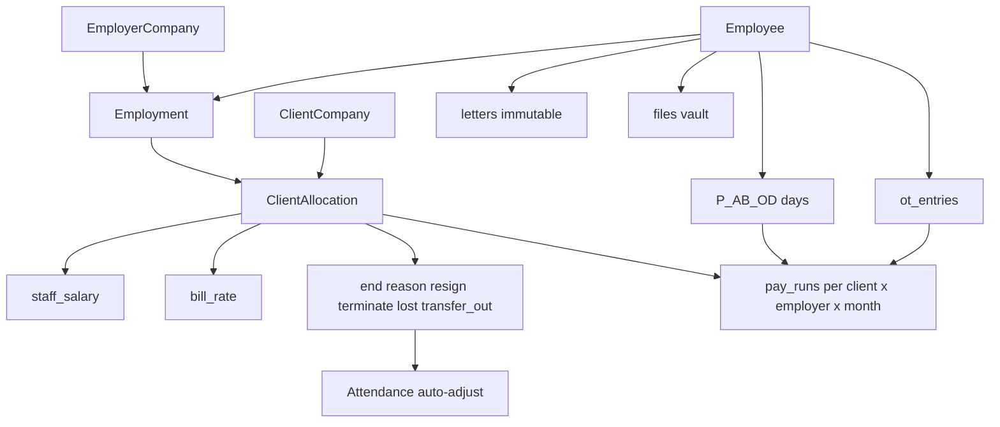

# NEXCRM Master Plan

Living map of the full codebase at `/home/server/dev/nexcrm`. Use this as the orientation document for product, architecture, and next work. Companion docs: [PRODUCT.md](PRODUCT.md), [ARCHITECTURE.md](ARCHITECTURE.md), [API.md](API.md), [DEPLOY.md](DEPLOY.md).

---

## 1. What NEXCRM is

Manpower-agency **super app**: legal employers second staff to client companies with dual rates (staff salary vs bill rate). Office SPA + Expo mobile share `/api/v1`. Finance starts as sidebar apps (Expenses shipped).

**Locked agency rules**

- Worker ↔ **employment** (legal employer) → **client allocation** (secondment + rates).
- Committed LOAs, allocations/events, locked pay runs, and files are **immutable** (correct via new events / new drafts).
- Attendance drives payroll via **calendar-day LOP**.
- Ending an allocation (resign / terminate / lost / transfer out) auto-adjusts attendance so mid-month leavers stay payroll-safe.

---

## 2. Repository layout

| Path | Role |
| --- | --- |
| `app/` | HTTP server, `*-http.ts` routers, SPA static, legacy HTML helpers |
| `modules/` | Domain logic |
| `lib/` | DB pool, env, migrate, Drizzle `schema.ts` |
| `db/migrations/` | Ordered SQL (`001`…`015`), applied on boot |
| `web/` | React + Vite + shadcn office SPA |
| `mobile/` | Expo client (partial parity) |
| `docs/` | Product / architecture / API / deploy / this master plan |
| `deploy/` | systemd, nginx, Postgres helpers |
| `tests/` | Node `--experimental-strip-types` smoke tests |

Boot (`app/server.ts`): migrate → `FILE_ROOT` → seed access (admin if empty) → listen → `/health` + SPA. No sample companies.

---

## 3. Domain model (current)

### End-allocation → attendance → payroll

| Reason | Last day | Attendance effect |
| --- | --- | --- |
| `resign` | Inclusive | Clear days **after** end date |
| `terminate` | Inclusive | Clear days **after** end date |
| `lost` | Inclusive | Mark **AB** from `absentFrom`…end date; clear after end |
| `transfer_out` | Inclusive | Clear days **after** end date |

Payroll includes **active and ended** allocations that overlap the month (so leavers still pay through last day). Formula: `net = (P+OD) × dayRate + OT` (rates are per day on employee → allocation); unmarked = AB.

**Generation modes**

1. **Client batch** — one draft per employer on that client.
2. **Employer × client** — single draft for one employer on one client.

---

## 4. Migrations (001–015)

| # | File | Purpose |
| --- | --- | --- |
| 001 | `001_companies.sql` | Companies, preferences, document snapshots |
| 002 | `002_projects.sql` | Employees, projects, sites, quota pools, slots |
| 003 | `003_work_permits.sql` | WP/passport enrichment |
| 004 | `004_access.sql` | Roles, users, sessions |
| 005 | `005_hr_loa.sql` | HR fields, document sequences, letters |
| 006 | `006_agency.sql` | Employer/client kind, files, employments, allocations, pay runs |
| 007 | `007_accommodations.sql` | Houses + stays |
| 008 | `008_system_settings.sql` | Settings KV (OpenAI) |
| 009 | `009_employee_photo.sql` | Employee photo file link |
| 010 | `010_expenses.sql` | Expenses app |
| 011 | `011_attendance.sql` | Daily attendance |
| 012 | `012_ot_rates.sql` | OT rates + entries |
| 013 | `013_attendance_od.sql` | Status `OD` |
| 014 | `014_payroll_lop.sql` | LOP columns + generation modes |
| 015 | `015_allocation_end.sql` | `end_reason` / `end_note` + event types |

---

## 5. Backend modules

| Module | Responsibility |
| --- | --- |
| `modules/access` | Auth, roles, sessions, seed admin |
| `modules/companies` | Employer/client CRUD, prefs |
| `modules/hr/employees` | Employee CRUD |
| `modules/hr/allocations` | Join / rate-change / **endAllocation** |
| `modules/hr/attendance` | Month sheet, bulk, period summary, **applyAllocationEndAttendance** |
| `modules/hr/payroll` | LOP engine, client_batch / employer_client, lock/recalc/delete |
| `modules/hr/ot` | Scoped rates + entries |
| `modules/hr/accommodations` | Houses, stays, charge preview |
| `modules/hr/onboard` + `passport-ocr` | Quick onboard / OCR |
| `modules/hr/work-permits` | Permit tracking |
| `modules/documents` | LOA letters + snapshots |
| `modules/expenses` | Expenses CRUD |
| `modules/files` | Disk vault under `FILE_ROOT` |
| `modules/projects` | Sites / pools / slots |
| `modules/settings` | OpenAI OCR config |

Empty placeholders (future): `compliance/`, `crm/`, `identity/`, `people/`, `recruitment/`, `resources/`.

### HTTP routers (`app/`)

| Router | Surface |
| --- | --- |
| `access-http.ts` | Login/logout/session/admin |
| `agency-http.ts` | Allocations (incl. `/end`), pay-runs, files, accommodations, onboard, OCR |
| `attendance-http.ts` | Attendance + month bulk + period-summary |
| `ot-http.ts` | OT rates/entries |
| `expenses-http.ts` | Expenses |
| `hr-http.ts` | Dashboard, employees, letters |
| `http.ts` | Guard + companies/projects/WP JSON + dispatch |

---

## 6. Web SPA (`web/`)

Shell: Workspace + Operations + Access; app icons above user footer.

| Route | Page |
| --- | --- |
| `/` | Dashboard |
| `/companies`, `/companies/:id` | Employers |
| `/clients` | Clients |
| `/employees`, onboard, detail | People |
| `/loas`, editor | LOAs |
| `/allocations` | Secondments + **Resign / Terminate / Lost / Transfer out** |
| `/attendance` | Month sheet, bulk tools, log, OT |
| `/payroll` | Dual-mode LOP pay runs |
| `/accommodations` | Housing |
| `/documents` | Vault |
| `/work-permits`, `/projects` | Ops |
| `/apps/expenses` | Expenses app |
| `/users`, `/admin`, `/settings` | Access |

---

## 7. Mobile (`mobile/`)

Expo Router; Tailscale HTTPS. Has login, companies, employees, clients, allocations, LOAs, payroll list, projects, permits. **Missing vs web:** attendance month sheet, accommodations, expenses, onboard OCR, end-allocation attendance messaging.

---

## 8. Auth model

- Cookie `nexcrm_session` (~12h).
- Roles include `system_admin`, `hr_manager`, `hr_staff`, `manager`, …
- Capability flags: preview / edit / delete.
- Admin/users/settings → system_admin only.

---

## 9. Feature status board

| Area | Status | Notes |
| --- | --- | --- |
| Companies / clients | Shipped | `kind` employer\|client |
| Employees + photo + OCR onboard | Shipped | |
| Allocations + dual rates | Shipped | |
| End allocation + attendance auto | Shipped | resign / terminate / lost / transfer_out |
| Attendance month + bulk | Shipped | Years 2000–2100 |
| OT rates/entries | Shipped | Feeds payroll |
| Payroll LOP dual mode | Shipped | Full calendar month only |
| LOA immutable + signed copy | Shipped | |
| Files vault | Shipped | Desktop `nexcrm-files` |
| Accommodations | Shipped | |
| Expenses app | Shipped | |
| Projects / quota | Shipped | Ops, not finance |
| Leave / holiday calendar | Deferred | |
| Bank payout / export | Deferred | |
| Investments / finance projects | Planned | Apps launcher |
| Recruitment / compliance modules | Deferred | Empty folders |
| Mobile attendance parity | Deferred | |

---

## 10. Tests (smoke)

| File | Covers |
| --- | --- |
| `tests/agency.test.ts` | Allocation, rates, resign path, pay lock, files |
| `tests/payroll-lop.test.ts` | LOP math, batch vs employer×client, mid-join |
| `tests/allocation-end.test.ts` | Terminate clears after end; lost marks AB; mid-period payroll |

Run: `node --experimental-strip-types tests/<file>.ts` from repo root (DB + env required).

---

## 11. Recommended next increments

1. **Leave / holiday policy** — approved leave → attendance/`OD` or paid leave status; holiday calendar for OD defaults.
2. **Mobile attendance + end allocation** — parity with web month sheet and end dialog.
3. **Payslip / PDF export** — print locked run; optional bank CSV later.
4. **Draft pay-run uniqueness UX** — surface “already exists” with open-existing deep link.
5. **Investments app** — next finance launcher tile after Expenses.
6. Retire or fully replace legacy SSR HTML routes under `projects-http` / `work-permits-http`.

---

## 12. Ops pointers

- Env: `DATABASE_URL`, `FILE_ROOT` (default Desktop `nexcrm-files`), `HOST`/`PORT`.
- Deploy: `docs/DEPLOY.md`, `deploy/nexcrm.service`.
- Migrations never hand-applied in prod without boot path — server applies on start under advisory lock.

---

*Last updated with attendance LOP payroll, dual generation modes, and allocation end actions (resign / terminate / lost / transfer_out) with automatic attendance adjustment.*
