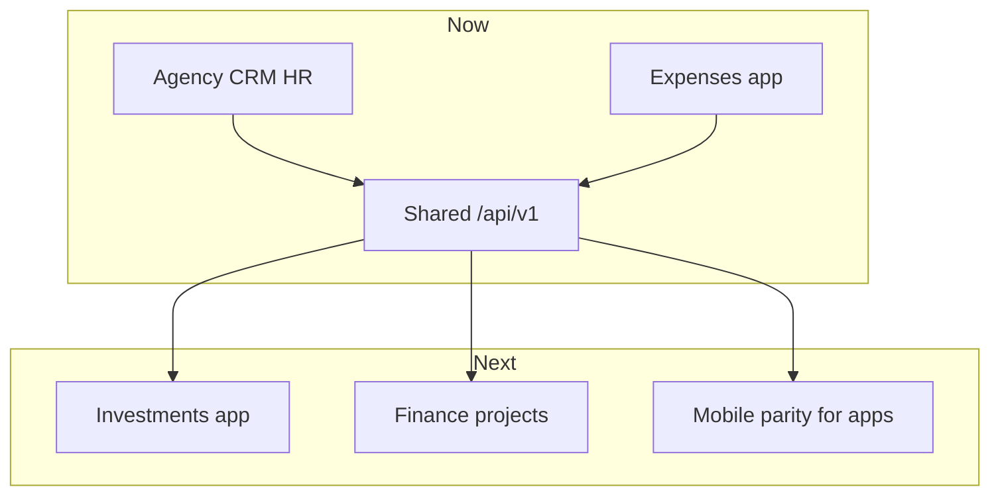

# Product map

NEXCRM is the office **super app** for a manpower agency that also runs light finance.

**Date display:** everywhere in the UI uses **DD MMM YYYY** (e.g. `04 Nov 2026`). APIs and `<input type="date">` fields still store/send ISO `YYYY-MM-DD`.

## Agency (core CRM / HR)

Primary navigation: **Workspace** + **Operations**.

| Area | Web routes | Purpose |
| --- | --- | --- |
| Dashboard | `/` | Headcount by client, counts, recent LOAs |
| Companies | `/companies`, `/companies/:id` | Employers & clients; letterhead / seal / signature uploads for LOAs |
| Employees | `/employees`, `/employees/onboard` | Records, photos, Quick Create (OCR or manual) |
| LOAs | `/loas`, `/loas/new` | Appointment letters (immutable snapshots) |
| Clients | `/clients` | Client companies + monthly rates by designation |
| Designations | `/designations` | Office-wide job titles (dropdown catalog for employees, rates, allocations) |
| Allocations | `/allocations` | Secondment + dual monthly rates |
| Attendance | `/attendance` | Monthly P/AB/OD day grid (any year 2000–2100), bulk tools, log, OT |
| Accommodations | `/accommodations` | Housing + charge preview |
| Payroll | `/payroll` | Monthly salary pay runs; export salary sheet + client payment request |
| Documents | `/documents` | Vault / passport flows |
| Work permits | `/work-permits` | Permit tracking |
| Projects | `/projects` | Sites, quota pools, slots |
| Settings | `/settings` (also `/users`, `/admin`) | Office hub: General, People, Roles, Health; OCR / region / currency |

### Agency rules (product)

- **You are the agency** (e.g. LEO Employment Services). Placement chain: **Legal employer → Project → Site → Quota pool → Slot → Employee**, then optionally **allocated** to a **client** for attendance/payroll. The agency is not the legal-employer column.
- **Clients are not projects.** A client (e.g. Ayada Maldives) is only the secondment / billing destination. Projects, sites, pools, and slots belong to the worker’s **legal employer**, never to the client company.
- **One client, many legal employers:** a client can host allocated workers from different WP holders at the same time. Each allocation keeps its own legal employer; payroll **client batch** opens one draft per employer on that client.
- **Designations** are a shared catalog (Labor, Mason, …). Add them once; pick via dropdown on employee, client rates, allocate, and onboard.
- **Staff salary** (pay worker) and **bill rate** (charge client) are separate monthly amounts by designation.
- **End allocation** quick actions: resign / terminate / lost / transfer out — with reason note. Attendance auto-clears after the last day; **lost** also marks AB from a chosen absent-from date. Mid-period leavers still appear in that month’s payroll through the end date.
- **Attendance** is marked manually per day (P / AB / OD) for any month/year; bulk fill and save-all are supported.
- **Payroll** uses monthly designation salaries: daily = monthly ÷ days-in-month; net = daily × paid days (P+OD) + OT. Full month present pays/bills the full monthly amount. Set rates on the client by designation (or employee defaults); allocate with start/end dates. Unmarked days count as AB. Export salary sheet and client payment request from a pay run.
- Payroll generation: **client batch** (one draft per employer on that client) or **employer × client** (single scoped draft). Locked runs are immutable; drafts can be recalculated or deleted.
- Committed allocations, LOAs, locked pay runs, and files are **immutable** — correct via new events, not silent edits.
- Passport **Quick onboard** uses ChatGPT Vision when an API key is configured in Settings.

## Finance apps (launcher)

Reached from the sidebar **app icons** above the user menu (`web/src/lib/apps.ts`), not from Operations.

| App | Short | Status | Route | API |
| --- | --- | --- | --- | --- |
| Expenses | EX | **Shipped** | `/apps/expenses` | `/api/v1/expenses` |
| Investments | IN | Planned | `/apps/investments` | `/api/v1/investments` |
| Finance projects | PR | Planned | `/apps/projects` or deepen CRM projects | TBD |

### Expenses (v1)

- Amount, date, currency (default MVR), note.
- Categories: **Client payment** (optional link to client company), **Investment** (free-text counterparty), **Other**.
- Filters + category totals on the page.

### Investments (planned)

Dedicated investment register (capital out / returns), separate from expense rows tagged `investment`. Keep expense category for quick cash-out logging until the register ships.

### Projects (finance lens, planned)

CRM already has operational **projects** (sites/slots). Finance projects may mean budgets, cost centres, or capital projects — decide whether to extend `projects` or add a finance-specific entity when implementing.

## Clients

| Client | Role |
| --- | --- |
| React web + PWA | Full office UI; installable on mobile browsers |
| Expo mobile | Field / on-the-go agency flows against the same API |

Both must stay API-compatible. Prefer shipping API + web first, then mobile screens.

## Roadmap sketch

