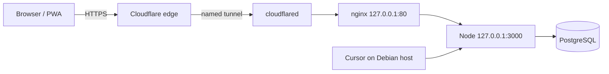

# Server & operations guides (JACMS)

Step-by-step guides for running **JACMS** (JA CRM — the planned product name for this monorepo, today still **NEXCRM** in code) on a **Debian desktop server** with **Cloudflare Tunnel** for public HTTPS. These docs complement the repo reference material in [DEPLOY.md](../DEPLOY.md) and [CLOUDFLARE_TUNNEL.md](../CLOUDFLARE_TUNNEL.md); follow those for script names, ports, and env vars.

## Who this is for

| Scenario | Start here |
| --- | --- |
| New Debian 16 GB RAM desktop as the office server; dev in **Cursor** on the same machine | [debian-server-setup.md](debian-server-setup.md) |
| Survive reboot / power loss without manual steps | [autostart-on-boot.md](autostart-on-boot.md) |
| Public URL `https://server.bluraymaldives.site` (no router port-forward) | [cloudflare-tunnel-server-bluraymaldives.md](cloudflare-tunnel-server-bluraymaldives.md) |
| Planned rename NEXCRM → JACMS (checklist only — no code change yet) | [jacms-rename-plan.md](jacms-rename-plan.md) |
| Future Expo Android preview APK / Metro on this host | [mobile-expo-android-preview.md](mobile-expo-android-preview.md) |

## Target architecture

| Component | Bind | Notes |
| --- | --- | --- |
| Node app | `127.0.0.1:3000` | `HOST` / `PORT` in `.env` — see [.env.example](../../.env.example) |
| nginx | `127.0.0.1:80` (+ optional LAN/Tailscale per [DEPLOY.md](../DEPLOY.md)) | Tunnel origin should be **nginx**, not Node directly |
| PostgreSQL | local socket (+ optional LAN TCP) | Never expose `:5432` through the tunnel |
| cloudflared | outbound to Cloudflare | systemd unit `cloudflared` |

## Related repo docs

| Doc | Purpose |
| --- | --- |
| [../DEPLOY.md](../DEPLOY.md) | nginx, systemd, Postgres network, day-2 commands |
| [../CLOUDFLARE_TUNNEL.md](../CLOUDFLARE_TUNNEL.md) | Tunnel concepts and `deploy/install-cloudflare-tunnel.sh` |
| [../REMOTE.md](../REMOTE.md) | Optional Tailscale SSH / Cursor remote |
| [../README.md](../README.md) | Docs index |

## Conventions in these guides

- **Placeholders** for secrets: `YOUR_CLOUDFLARE_TOKEN`, `YOUR_DB_PASSWORD`, etc. Never commit real credentials.
- Paths use today’s layout (`/home/server/dev/nexcrm`); [jacms-rename-plan.md](jacms-rename-plan.md) lists planned renames.
- Commands assume **Debian stable** (current bookworm or successor) and a dedicated `server` (or similarly named) Unix user.
