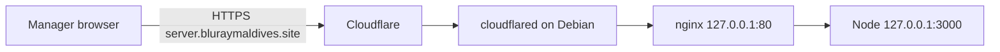

# Cloudflare Tunnel — `server.bluraymaldives.site`

Expose JACMS (today **NEXCRM** in code) at **`https://server.bluraymaldives.site`** without ISP port-forwarding. Traffic path matches [CLOUDFLARE_TUNNEL.md](../CLOUDFLARE_TUNNEL.md): **Cloudflare edge → cloudflared → nginx `http://127.0.0.1:80` → Node `http://127.0.0.1:3000`**.

## Prerequisites

1. Domain **`bluraymaldives.site`** on a Cloudflare account with **DNS managed by Cloudflare**.
2. Debian server with `nexcrm` + `nginx` healthy locally ([debian-server-setup.md](debian-server-setup.md)).
3. Router: **no** WAN port map for 80/443 (tunnel is outbound-only).
4. Host stack enabled on boot ([autostart-on-boot.md](autostart-on-boot.md)).

## Architecture



| Item | Value |
| --- | --- |
| Public hostname | `server.bluraymaldives.site` |
| Tunnel name (default in script) | `nexcrm` → planned `jacms` — [jacms-rename-plan.md](jacms-rename-plan.md) |
| Origin | `http://127.0.0.1:80` (not `:3000` directly) |
| Credentials | `/etc/cloudflared/config.yml` + JSON under `/root/.cloudflared/` — **never commit** |

## Step 1 — Install cloudflared binary

From repo root:

```bash
cd /home/server/dev/nexcrm
sudo bash deploy/install-cloudflare-tunnel.sh
```

Without `--hostname`, the script only installs the package and prints next steps (same as [CLOUDFLARE_TUNNEL.md](../CLOUDFLARE_TUNNEL.md)).

## Step 2 — Authorize Cloudflare (one-time)

Run on the server (opens a browser URL; use a one-time login on a machine with a browser if headless):

```bash
cloudflared tunnel login
```

This creates a certificate under `~/.cloudflared/cert.pem` (often copied to `/root/.cloudflared/cert.pem` for the service). **Do not share** this file.

## Step 3 — Create named tunnel + DNS

Use the repo installer with your hostname:

```bash
cd /home/server/dev/nexcrm
sudo bash deploy/install-cloudflare-tunnel.sh \
  --hostname server.bluraymaldives.site \
  --tunnel-name nexcrm
```

What the script does (see `deploy/install-cloudflare-tunnel.sh`):

1. Installs `cloudflared` from Cloudflare’s `.deb` if missing.
2. Creates or reuses tunnel named `nexcrm`.
3. Writes `/etc/cloudflared/config.yml` similar to:

```yaml
tunnel: <TUNNEL_UUID>
credentials-file: /root/.cloudflared/<TUNNEL_UUID>.json

ingress:
  - hostname: server.bluraymaldives.site
    service: http://127.0.0.1:80
  - service: http_status:404
```

4. Runs `cloudflared tunnel route dns nexcrm server.bluraymaldives.site` (CNAME to `*.cfargotunnel.com`).
5. `cloudflared service install`, `systemctl enable --now cloudflared`.

Placeholders: real `TUNNEL_UUID` and JSON credentials are generated by Cloudflare — not documented here.

## Step 4 — Verify

Local:

```bash
curl -fsS http://127.0.0.1/health
curl -fsS http://127.0.0.1:3000/health
systemctl status cloudflared
journalctl -u cloudflared -n 50 --no-pager
```

Public:

```bash
curl -fsS https://server.bluraymaldives.site/health
```

Browser: open `https://server.bluraymaldives.site/` — NEXCRM/JACMS login page.

### Mobile / API base URL

Point Expo and other clients at:

```text
https://server.bluraymaldives.site
```

(No trailing path; API is `/api/v1`.)

## Day-2 operations

```bash
sudo systemctl restart cloudflared
sudo systemctl reload nginx
sudo systemctl restart nexcrm
journalctl -u cloudflared -f
```

After web UI changes:

```bash
cd /home/server/dev/nexcrm/web && npm run build
sudo systemctl restart nexcrm
```

## Security limits

- App authentication unchanged — tunnel is not a substitute for login.
- **Never** add a tunnel ingress to PostgreSQL `:5432`.
- Prefer nginx in front of Node for headers/body limits ([CLOUDFLARE_TUNNEL.md](../CLOUDFLARE_TUNNEL.md)).
- Optional later: **Cloudflare Access** (email OTP) in front of the hostname.

## Troubleshooting

| Symptom | Action |
| --- | --- |
| **Cloudflare Error 1033** | Connector down — see [autostart-on-boot.md](autostart-on-boot.md#cloudflare-error-1033-in-the-browser) |
| 502 at public URL | Fix `curl http://127.0.0.1/health`; restart `nexcrm` and `nginx` |
| Wrong site / 404 | Check `hostname` in `/etc/cloudflared/config.yml` matches `server.bluraymaldives.site` |
| DNS not proxied | In Cloudflare DNS, CNAME should be **Proxied** (orange cloud) |

## Ephemeral test (no DNS)

```bash
cloudflared tunnel --url http://127.0.0.1:80
```

Random `*.trycloudflare.com` URL — for debugging only, not production managers.

## Related

- Generic tunnel doc: [../CLOUDFLARE_TUNNEL.md](../CLOUDFLARE_TUNNEL.md)
- Boot ordering: [autostart-on-boot.md](autostart-on-boot.md)
- Product rename (tunnel name `jacms`): [jacms-rename-plan.md](jacms-rename-plan.md)
